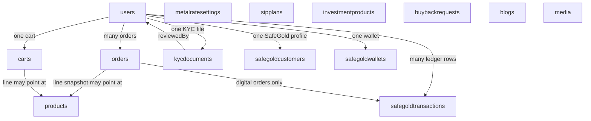
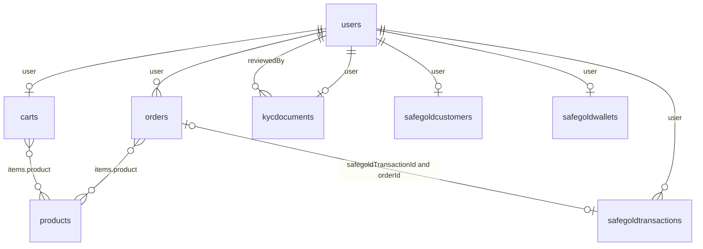
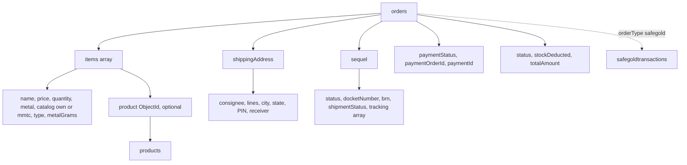
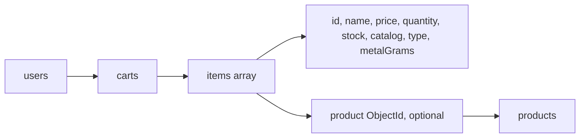
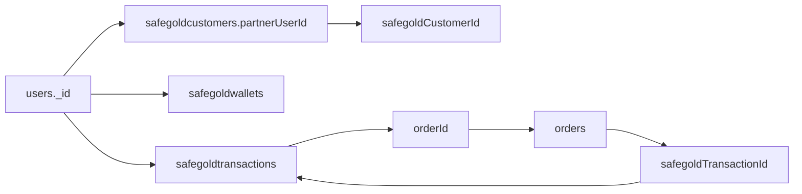
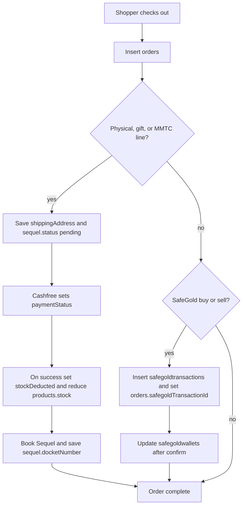

# Database structure

The API uses MongoDB through Mongoose. The connection string is `MONGODB_URI` in `backend/.env`. If that variable is missing, the app connects to `mongodb://localhost:27017/goldnsilver`. Switching databases is done only by changing `MONGODB_URI`.

Every collection below is created from a model in `backend/src/models/`. Mongoose pluralises the model name (`User` becomes `users`, `SafeGoldTransaction` becomes `safegoldtransactions`). Documents also receive `createdAt` and `updatedAt` unless noted.

Diagrams of the collections and their links are in [Table links](#table-links).

Related documents:

- [Frontend and backend structure](./frontend-and-backend.md)
- [Third-party integrations](./third-party-integrations.md)
- [DigiLocker KYC](./digilocker.md)

## Users — `users`

Customer and admin accounts.

| Field | Notes |
| --- | --- |
| `name`, `email`, `passwordHash` | Email is unique |
| `mobile` | Optional, sparse unique index. Indian mobile checks happen in the register form |
| `userType` | `general` or `admin` |
| `role` | `user` or `admin`. Admin routes require both `userType`/`role` admin and an admin JWT |
| `kycStatus` | `not_submitted`, `pending`, `approved`, `rejected` |
| `kycMethod` | `digilocker` or `manual` |
| `kycSubmittedAt`, `kycVerifiedAt`, `kycRejectedReason` | Review trail |
| `pinCode` | Optional, also used as a SafeGold default when set |

Passwords are stored only as `passwordHash` (bcrypt).

## Products — `products`

The shop catalogue. Own products and MMTC-PAMP products live in this one collection and are separated by `catalog`.

| Field | Notes |
| --- | --- |
| `name`, `slug` | Slug is unique. The admin form regenerates it from the name |
| `catalog` | `own` (default) or `mmtc-pamp`. Indexed |
| `metal` | `gold`, `silver`, or `gold+silver` |
| `type` | `digital`, `physical_coin`, `physical_bar`, `gifting`, `sip`, `fund`, `etf`, `sovereign_bond` |
| `pricingMode` | `rate_based` or `fixed`. MMTC seed rows are `fixed` |
| `pricePerUnit` | Rupees per unit. Checkout multiplies this by quantity on the server |
| `metalGrams` | Used for rate-based pricing and for the weight shown on digital and physical lines |
| `stock` | Non-negative. Decremented once when a paid order sets `stockDeducted` |
| `unit` | Default `gram` |
| `imageUrl`, `description`, `category`, `isFeatured`, `isActive` | Merchandising |
| `tags`, `displayName`, `sku`, `shape`, `purity`, `dimension`, `countryOfOrigin`, `importer`, `denomination`, `mrp`, `sortOrder` | Used by the MMTC catalogue. Own products usually leave these empty |

Public `GET /api/products` returns `catalog != mmtc-pamp` unless the query asks for `mmtc-pamp`, `mmtc`, or `all`.

MMTC rows are seeded on server start when their slug is missing. Seeded image paths look like `/mmtc/mmtc-1.png` and are served from `frontend/public/mmtc/`.

## Carts — `carts`

One cart document per signed-in user (`user` is unique).

Each item stores `id`, optional `product` ObjectId, `name`, `price`, `quantity`, `stock`, `imageUrl`, `metal`, `catalog` (`own` or `mmtc`), `type`, and `metalGrams`. Guest carts stay in the browser until login merges them.

## Orders — `orders`

One document per checkout, whether the line is physical, gift, MMTC, ETF, or SafeGold.

| Field | Notes |
| --- | --- |
| `user` | Shopper. Null for a guest order. Must not be set to the gate super-admin just because the site sent a gate token |
| `orderType` | `product` or `safegold` |
| `safegoldTransactionId` | Link to `safegoldtransactions` for digital buys and sells |
| `items[]` | Snapshot at purchase time. See below |
| `status` | Fulfilment: `pending`, `paid`, `failed`, `shipped`, `delivered`, `completed`, `cancelled`. This is the admin **Product status** |
| `paymentStatus` | `pending`, `success`, or `failed`. The admin **Order status** column shows `success` or `failed` from this field |
| `paymentProvider` | `cashfree` for live checkout. The enum still lists `razorpay`, `stripe`, and `mock` |
| `paymentOrderId`, `paymentId` | Cashfree order id looks like `order_<timestamp>_<random>` |
| `totalAmount`, `currency` | Currency defaults to `INR` |
| `customerName`, `customerEmail`, `customerPhone` | Copy of the checkout contact |
| `liveGoldRateAtPurchase`, `liveSilverRateAtPurchase` | Rates captured for the order |
| `stockDeducted` | `true` after catalogue stock has been reduced for this paid order |
| `shippingAddress` | Consignee, two address lines, city, state, PIN, and authorised receiver name, phone, and email |
| `requiresSequelShipment` | `true` for physical gold, silver, and gifting lines |
| `sequel` | Shipment subdocument. See below |

**Order item**

| Field | Notes |
| --- | --- |
| `product` | ObjectId, optional for SafeGold lines that are not catalogue rows |
| `name` | Digital lines are stored as `Digital Gold (SafeGold)`. Older rows may still say “SafeGold Physical Gold”; the user orders API rewrites those labels |
| `price`, `quantity` | Price is per unit |
| `metal` | `gold`, `silver`, or `gold+silver` |
| `catalog` | `own` or `mmtc` on the line. This is the label shown in the cart and dashboards. The product document uses `mmtc-pamp`; the line stores `mmtc` |
| `type` | Product type copied onto the line (`physical_coin`, `etf`, and so on) |
| `metalGrams` | Weight for the line. Digital weight is this field, not part of `name` |
| `purchaseRatePerGram` | Rate used for that line |

**Sequel subdocument**

| Field | Notes |
| --- | --- |
| `status` | `not_required`, `pending`, `booked`, `in_transit`, `delivered`, `cancelled`, `failed` |
| `docketNumber`, `brn` | Sequel docket and BRN |
| `fromStoreCode` | Warehouse code sent at booking |
| `estimatedDelivery`, `shipmentStatus` | Latest carrier text or event code |
| `tracking` | Array of Sequel tracking events (`description`, `location`, `date_time`, `code`) |
| `trackingUrl`, `docketPrintUrl` | Links |
| `bookedAt`, `lastError` | Booking time and the last carrier error |

The 10-minute sync updates `sequel` and, when the carrier says the parcel moved, also moves `status` from `paid` to `shipped` or `delivered`. Delivered and cancelled dockets are not polled again.

Customer dashboards hide rows whose payment failed or that were never paid. A row is shown when `paymentStatus` is `success` or `status` is `paid`, `shipped`, `delivered`, or `completed`.

## SafeGold customers — `safegoldcustomers`

One row per app user who has been registered with SafeGold.

| Field | Notes |
| --- | --- |
| `user` | Unique link to `users` |
| `partnerUserId` | Unique. This is the Mongo user id sent to SafeGold |
| `safegoldCustomerId` | Id returned by SafeGold |
| `name`, `phoneNo` | Copy used at registration |
| `status` | `pending`, `active`, `failed` |
| `registeredEnv` | `staging` or `production`. A staging customer id cannot be used for a production buy |
| `registeredAt`, `lastSyncedAt`, `lastError` | Sync bookkeeping |

## SafeGold wallets — `safegoldwallets`

One wallet per user.

| Field | Notes |
| --- | --- |
| `balanceGrams`, `sellableBalanceGrams` | Holdings |
| `safegoldUserId` | SafeGold user id |
| `balanceSource` | `local` or `safegold` |
| `lastSyncedAt` | Last balance pull |

## SafeGold transactions — `safegoldtransactions`

Buy and sell ledger. Indexed by `user` + `createdAt`, and `clientReferenceId` is unique.

| Field | Notes |
| --- | --- |
| `type` | `buy` or `sell` |
| `status` | `pending`, `processing`, `success`, `failed` |
| `clientReferenceId` | Idempotency key sent to SafeGold |
| `rateId`, `currentPrice`, `applicableTax`, `sgRate` | Quote |
| `goldAmount`, `buyPrice` | Grams and rupees. Sells also store the sell amount in `buyPrice` |
| `paymentProvider`, `paymentOrderId`, `paymentId` | Cashfree linkage for buys |
| `orderId` | Back-link to `orders` |
| `buyTxId`, `sellTxId`, `transferTxId` | SafeGold transaction ids |
| `invoiceId`, `invoiceUrl`, `invoiceFetchedAt` | Invoice lookup |
| `settledStatus`, `safegoldUserId`, `failureReason` | Settlement and errors |

## KYC documents — `kycdocuments`

One document per user.

| Field | Notes |
| --- | --- |
| `method` | `digilocker` or `manual` |
| `fullName`, `panNumber`, `aadhaarLast4`, `dateOfBirth` | Identity |
| `address` | `line1`, `line2`, `city`, `state`, `pincode` |
| `aadhaarNumber` | Full 12-digit Aadhaar when DigiLocker sends it. Empty when only a masked UID is returned |
| `digilocker` | `requestId` (DigiLocker id), `status` (`initiated`, `completed`, `failed`), verified name, PAN, Aadhaar last four, `panUri`, `referenceKey` |
| `documents` | `panFront`, `aadhaarFront`, `aadhaarBack`, each with `fileKey`, original name, mime type, and size |
| `status` | `pending`, `approved`, `rejected` |
| `reviewedBy`, `reviewedAt`, `rejectionReason` | Admin review |
| `consentAccepted`, `consentAt` | Consent |

Checkout calls KYC only when the server-side order value is at least 200000 rupees.

## Metal rate settings — `metalratesettings`

A single settings row (`key: 'global'`) with `goldPerGram` and `silverPerGram`. Live shop rates come from Zerodha, not from this document. Bulk “apply rates” uses the admin values for rate-based **own** products and skips `mmtc-pamp` and fixed-price products.

## Other catalogues

**SIP plans — `sipplans`.** `name`, `metal`, `type` (`digital_gold_sip`, `mutual_fund_sip`, `gold_accumulation`, `goal_based`), `goal`, `minInstallment`, `frequency` (`monthly` or `weekly`), `tenureMonths`, `description`, `isActive`.

**Investment products — `investmentproducts`.** Marketing catalogue separate from `products`. `category` includes `digital`, `sip`, `mutual_fund`, `etf`, `sovereign_bond`, `coin`, `bar`, `gifting`, `lease`. Also `provider`, `minAmount`, `maxAmount`, `tags`, `isActive`.

**Buyback requests — `buybackrequests`.** `customerName`, `metal` (`gold` or `silver`), `weightInGrams`, `estimatedValue`, `status` (`pending`, `approved`, `rejected`, `paid`), `payoutMethod` (`wallet` or `bank_transfer`), `notes`.

**Blogs — `blogs`.** `title`, unique `slug`, `excerpt`, `content`, `category`, `imageUrl`, `isPublished`.

**Media — `media`.** `title`, `type` (`press`, `news`, `gallery`), `description`, `imageUrl`, `link`, `isPublished`.

## Table links

Collections drawn with a solid border are stored as their own MongoDB collections. Boxes inside `orders` and `carts` are embedded documents, not separate tables. A guest checkout can save an order with no `user`.

### All collections

`metalratesettings`, `sipplans`, `investmentproducts`, `buybackrequests`, `blogs`, and `media` do not store a user or product id. Buyback requests keep the customer name as text.

### How many rows link

`||--o|` is one user to at most one child. `||--o{` is one user to many children. Product links are optional because a SafeGold line does not have to reference a catalogue product.

### What sits inside an order

### What sits inside a cart

### SafeGold records for one customer

### Checkout write order

KYC is not a new collection on every checkout. The `kycdocuments` row is created only when the shopper submits KYC, and checkout reads it only when the server-side order value is at least ₹2,00,000.
